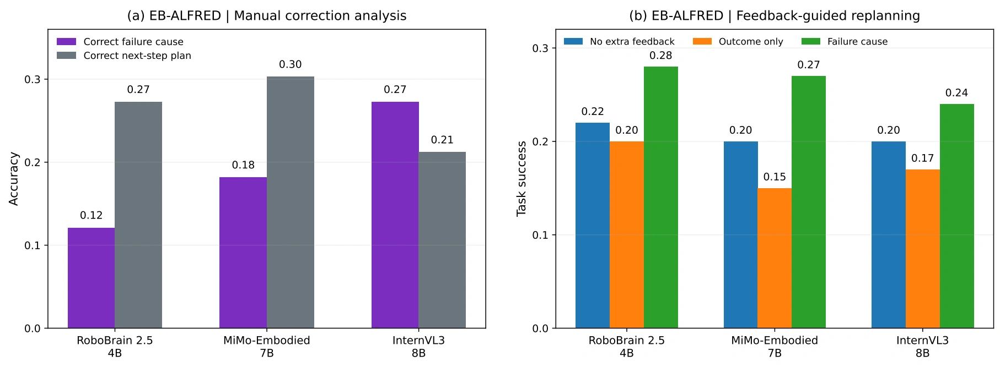
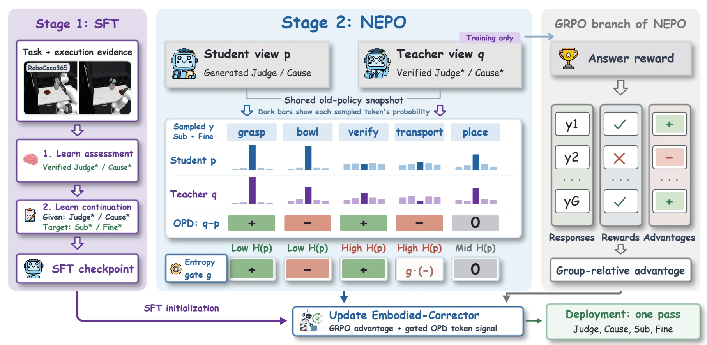
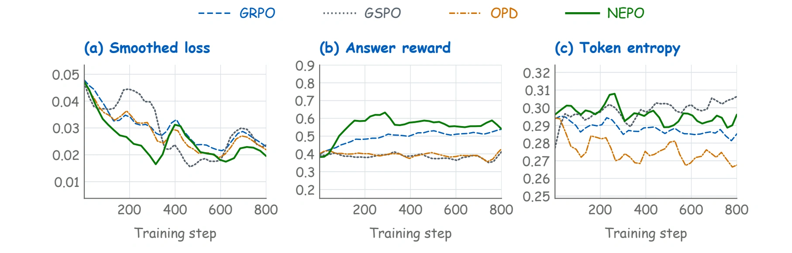
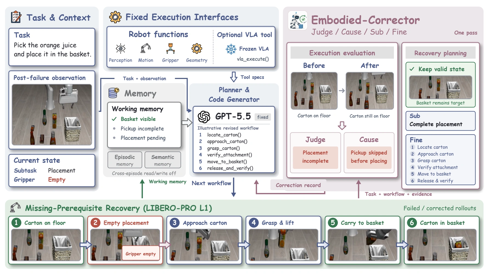

<div align="center">

# Embodied-Corrector

**Recover, don’t just continue.**

**Learning from Feedback for Physical Failure Understanding and Correction**

[](https://github.com/pm1255/embodied-corrector)
[](https://pm1255.github.io/embodied-corrector/)

**English** · [Chinese](README_zh.md)

</div>

## Overview

Watch the [research introduction](https://pm1255.github.io/embodied-corrector/#video) and the [12 distinct recovery tasks](https://pm1255.github.io/embodied-corrector/?v=distinct-tasks-12#simulations) on the project page.

Research overview with English narration and subtitles. Robot motion comes from continuous simulator recordings.

## Selected successful recoveries

[Watch all 12 current videos](https://pm1255.github.io/embodied-corrector/?v=distinct-tasks-12#simulations): **six different LIBERO-PRO tasks and six different RoboCasa365 tasks**. Every RoboCasa task combines navigation and manipulation.

Each continuous recording shows two deliberate action errors, followed by English **Judge → Cause → Sub → Fine** explanations, corrections, and a successful final environment check. The opening has no premature Judge/Cause label. Every action frame is retained at **native 20 fps and 1× speed**, with a three-second final hold and a first-frame cover.

These are **GPT-authored, simulator-state-assisted demonstrations**, separate from trained Embodied-Corrector / RynnBrain inference and benchmark scores. Brief startup settling and physical contact transients remain in the recordings. See [provenance and verification](guides/selected_recoveries.md).

| Suite | Original task and current video | Deliberate errors |
| --- | --- | --- |
| LIBERO-PRO | [Put the black bowl in the bottom drawer of the cabinet and close it](https://pm1255.github.io/embodied-corrector/?v=distinct-tasks-12#case-distinct-recovery-01-drawer) | high grasp; partial drawer closure with hand withdrawal |
| LIBERO-PRO | [Put the yellow and white mug in the microwave and close it](https://pm1255.github.io/embodied-corrector/?v=distinct-tasks-12#case-distinct-recovery-02-microwave) | lateral grasp offset; incomplete door closure |
| LIBERO-PRO | [Turn on the stove and put the moka pot on it](https://pm1255.github.io/embodied-corrector/?v=distinct-tasks-12#case-distinct-recovery-03-stove) | missed switch contact; placement offset |
| LIBERO-PRO | [Put both the cream cheese box and the butter in the basket](https://pm1255.github.io/embodied-corrector/?v=distinct-tasks-12#case-distinct-recovery-04-basket) | lateral grasp offset; placement outside basket |
| LIBERO-PRO | [Put the white mug on the left plate and put the yellow and white mug on the right plate](https://pm1255.github.io/embodied-corrector/?v=distinct-tasks-12#case-distinct-recovery-05-mugs) | high grasp; placement on wrong plate |
| LIBERO-PRO | [Pick up the book and place it in the back compartment of the caddy](https://pm1255.github.io/embodied-corrector/?v=distinct-tasks-12#case-distinct-recovery-06-book) | lateral grasp offset; placement outside organizer |
| RoboCasa365 | [Place the fruits in the fridge on the cutting board by the sink to make a fruit bowl. Leave the non-fruit items in the fridge.](https://pm1255.github.io/embodied-corrector/?v=distinct-tasks-12#case-distinct-recovery-07-fruits) | wrong-direction navigation; missed fruit grasp |
| RoboCasa365 | [Transport the chicken drumstick from the fridge to the microwave and turn on the microwave.](https://pm1255.github.io/embodied-corrector/?v=distinct-tasks-12#case-distinct-recovery-08-thaw) | high grasp; incomplete microwave door closure |
| RoboCasa365 | [Pick the mug from the cabinet, place it under the coffee machine dispenser, and press the start button.](https://pm1255.github.io/embodied-corrector/?v=distinct-tasks-12#case-distinct-recovery-09-coffee) | wrong-direction navigation; missed start button |
| RoboCasa365 | [Pick up the cup and bowl from the counter, place them in the dishwasher, and close the dishwasher door.](https://pm1255.github.io/embodied-corrector/?v=distinct-tasks-12#case-distinct-recovery-10-dishwasher) | high grasp; premature door-closing withdrawal |
| RoboCasa365 | [Pick the tangerine, cucumber from the counter and place them in the cabinet. Then close the cabinet.](https://pm1255.github.io/embodied-corrector/?v=distinct-tasks-12#case-distinct-recovery-11-cleanup) | wrong-direction navigation; high grasp |
| RoboCasa365 | [Move the pot and pan from the stove into the sink.](https://pm1255.github.io/embodied-corrector/?v=distinct-tasks-12#case-distinct-recovery-12-cookware) | lateral handle-grasp offset; wrong-direction navigation |

**Final cookware video:** [Play the MP4](https://pm1255.github.io/embodied-corrector/assets/recovery/distinct-recovery-12-cookware.mp4) · [Execution record](docs/assets/recovery/distinct-recovery-12-cookware.json).

## Abstract

Reliable embodied execution requires physical causal understanding, adaptation to the executor’s capabilities, and revision from interaction feedback. **Embodied-Corrector**, trained from **RynnBrain-8B**, connects observed failures with diagnosis and executable recovery through **Judge → Cause → Sub → Fine**. We construct controlled failure–recovery branches from successful trajectories, changing one physical factor at a time. **Evaluation-first SFT** learns assessment before planning; **NEPO** combines group-relative rewards with entropy-gated token-level guidance across generated and verified evaluation contexts. At inference time, the model uses public observations and within-episode history without parameter updates. The manuscript reports improvements in failure reasoning, planning transfer, and recovery with fixed execution backends, including **55.0% → 68.9%** macro-average success with a fixed code backend and **1.2% → 7.3%** on RoboCasa365 Composite-Unseen with frozen π₀.₅.

## Motivation

Multimodal models can understand instructions, perceive scenes, and generate plans. Physical execution, however, is jointly constrained by the embodiment, controller, and environment. When an action produces an unexpected outcome, continuing the original plan can repeat the same failure. We ask: **how can an embodied brain understand why execution failed and turn interaction feedback into a recovery that its current executor can realize?**

We identify three complementary capabilities:

- **Physical causal understanding and failure localization:** trace execution to the action, physical relation, or unmet prerequisite that first invalidated progress—for example, distinguish mistimed grasping from an unsuitable contact pose or an omitted earlier step.
- **Execution-capability identification and adaptation:** adapt the content and granularity of recovery instructions to the current state and executor, producing subtasks a fixed controller or frozen VLA can carry out.
- **Learning from interaction experience:** use previous actions, observations, and correction outcomes as evidence for the next decision, adapting through context without updating model parameters at inference time.

<p align="center"></p>

## Method

We introduce **Embodied-Corrector**, trained from **RynnBrain-8B** with evaluation-first SFT and NEPO, which turns physical execution feedback into failure diagnosis and executable recovery. Its structured reasoning follows **Judge → Cause → Sub → Fine**: assess the execution outcome, identify the failure cause, select a recovery subtask, and provide fine-grained action guidance. Recovery planning is thus grounded in an assessment of what actually happened.

<p align="center"></p>

1. **Controlled failure–recovery data.** Branch successful trajectories at subtask boundaries and intervene on one physical factor to connect actions, observable consequences, causes, and recoveries. Retain observable, recoverable failures and split source trajectories before generating perturbations.
2. **Evaluation-first supervised fine-tuning.** Learn outcome judgment and cause analysis (Judge/Cause), then learn recovery planning (Sub/Fine) conditioned on verified evaluations, connecting diagnosis with planning.
3. **NEPO policy optimization.** Address the mismatch between verified evaluations used during training and model-generated evaluations at deployment. The same policy scores identical planning tokens under the two evaluation contexts. Noise-Aware Entropy-Gated Policy Optimization (**NEPO**) combines group-relative rewards with token probability differences, preserves positive guidance, and uses entropy gating to attenuate uncertain negative signals.
4. **Closed-loop correction from interaction history.** Observe outcomes, diagnose failures, and revise subsequent plans while keeping the execution backend fixed. Within-episode actions and feedback inform the next decision without parameter updates at inference time.

Verified evaluations are used only during training. At deployment, the model generates all four fields from observable execution evidence. See the [method guide](guides/method.md) for equations and their correspondence to the implementation.

## Experiments

The paper evaluates the corrective brain from **failure diagnosis → planning transfer → closed-loop recovery**. All results below are reported in the manuscript and measured in simulation.

| Setting | Comparison | Baseline | Embodied-Corrector | Gain | Source |
| --- | --- | ---: | ---: | ---: | --- |
| Fixed code backend | RynnBrain-8B → RynnBrain-NEPO; macro-average across 10 conditions | 55.0% | 68.9% | +13.9 pp | Table 3 |
| Frozen π₀.₅ | RoboCasa365 Composite-Unseen; add corrective brain | 1.2% | 7.3% | +6.1 pp | Figure 4 |
| Planning transfer | EB-ALFRED Base; RynnBrain-8B → RynnBrain-NEPO | 30% | 78% | +48 pp | Table 2 |
| Failure judgment | EmbodiedDiag-Bench Navigation; Judge | 23.6% | 79.6% | +56.0 pp | Table 1 |
| Cause diagnosis | EmbodiedDiag-Bench Navigation; Cause | 13.6% | 58.2% | +44.6 pp | Table 1 |

The code-backend comparison fixes the GPT-5.5 planner, analytic robot functions, perception, and execution budget; its macro-average covers four OmniBehavior and six LIBERO-PRO conditions. The frozen-VLA gain is specific to **Composite-Unseen**; Atomic-Seen can regress when unnecessary instruction changes are introduced. Planning transfer uses identical observation/action interfaces and step limits, without an explicit failure prompt or corrective Harness. The paper results are documented separately from the code execution instructions below.

[Explore all four evaluation settings and full result tables →](https://pm1255.github.io/embodied-corrector/#results)

<p align="center"></p>

## Installation

Linux, Python 3.12 and a CUDA GPU are recommended. Install [uv](https://docs.astral.sh/uv/getting-started/installation/), then:

```bash
git clone https://github.com/pm1255/embodied-corrector.git
cd embodied-corrector
bash scripts/setup.sh
```

The repository vendors **verl v0.9.1** at a fixed commit. PyTorch is installed separately from the CUDA 12.8 wheel index; other core versions are pinned in [requirements-core.txt](requirements-core.txt). The exact environment used for validation is documented separately in [guides/validation.md](guides/validation.md).

## Training

The project uses **RynnBrain-8B → evaluation-first SFT → NEPO → Embodied-Corrector**. The commands below show how to prepare data, train the corrective model, and run the evaluation interfaces with RynnBrain.

### RynnBrain training workflow

Prepare a local copy of the **RynnBrain-8B** checkpoint, including model weights, tokenizer and processor files:

```bash
export EC_MODEL=/models/RynnBrain-8B
bash scripts/validate_gpu.sh
```

This prepares the environment and runs the repository's numerical, multimodal, SFT, NEPO, checkpoint, and evaluation stages with RynnBrain.

For your own dataset:

```bash
source scripts/env.sh
"$EC_PYTHON" -m ec_verl.data split --input /data/all.jsonl --output /data/split
"$EC_PYTHON" -m ec_verl.data validate \
  --train /data/split/train.jsonl --eval /data/split/eval.jsonl

bash scripts/train.sh \
  --model "$EC_MODEL" \
  --train /data/split/train.jsonl --eval /data/split/eval.jsonl \
  --output runs/my-run --device cuda --dtype bfloat16 --lora \
  --scope formal --sft-steps 1000 --nepo-steps 500 --group-size 4 \
  --kappa 1 --beta .5 --opd-coef 1
```

These hyperparameters are engineering examples, not values disclosed by the paper. Split by original source trajectory before constructing perturbation branches. Image inputs require a vision-language model. See [data schema](guides/data.md) and [training guide in Chinese](guides/training_zh.md).

## EmbodiedBench evaluation

<p align="center"></p>

The adapter executes the official **EBAlfEnv**. RynnBrain provides the planner and the trained corrective checkpoint provides Judge → Cause → Sub → Fine outputs. Only public observations, actions and feedback enter model prompts; task success is measured using the environment's own predicate.

After preparing the pinned EmbodiedBench repository, task data, AI2-THOR build and display dependencies described in [the environment guide](guides/embodiedbench.md):

```bash
export EC_EB_ROOT=/path/to/EmbodiedBench
export EC_THOR_EXECUTABLE=/path/to/thor-201909061227-Linux64
export EC_CORRECTOR="$PWD/runs/rynnbrain/checkpoints/nepo-0002"
bash scripts/validate_embodiedbench.sh
```

The default run evaluates one base-subset simulation task with a 30-decision budget. Per-step images, actions, raw and normalized corrections, environment feedback and final metrics are saved. The script closes its inference and display processes on exit.

This command runs the RynnBrain planner and corrective interface against EBAlfEnv. Habitat, Navigation and Manipulation backends are not implemented here.

## DiagBench evaluation

The released EmbodiedDiag-Bench small dataset and its collect → visual judge → aggregate protocol are integrated. Run the collect, judge, and aggregate commands in the [evaluation guide](guides/diagbench.md) with RynnBrain and your configured vision judge. Pinned downloads, integrity checks, safe resume, and TensorBoard are included.

## Monitoring

```bash
source scripts/env.sh
"$EC_PYTHON" -m tensorboard.main \
  --logdir "$EC_ROOT/runs" --port 6006 --bind_all --load_fast=false
```

Open `http://localhost:6006`. Logs include stage waiting/running/completed/failed states, SFT loss, NEPO reward/entropy/probability gap, gradients, checkpoints and evaluation progress.

## Repository structure

```text
.
├── ec_verl/          # SFT, NEPO, inference and benchmark adapters
├── scripts/          # Setup, training and validation entry points
├── configs/          # Documented smoke-run settings
├── data/             # Four labeled teaching examples
├── tests/            # Numerical, leakage and interface checks
├── guides/           # Method, data, environment and validation notes
├── validation/       # Small machine-readable verification records
├── docs/             # Author-free project page for GitHub Pages
└── vendor/verl/      # Pinned upstream verl source and license
```

## Citation

If you find this work useful for your research, please cite Embodied-Corrector. The formal paper BibTeX will be added when its citation metadata is released. For now, the following entry cites the project page.

```bibtex
@misc{embodiedcorrector2026,
  title        = {Embodied-Corrector},
  year         = {2026},
  howpublished = {Project page},
  url          = {https://pm1255.github.io/embodied-corrector/}
}
```

[Download the project citation](docs/citation.bib)
