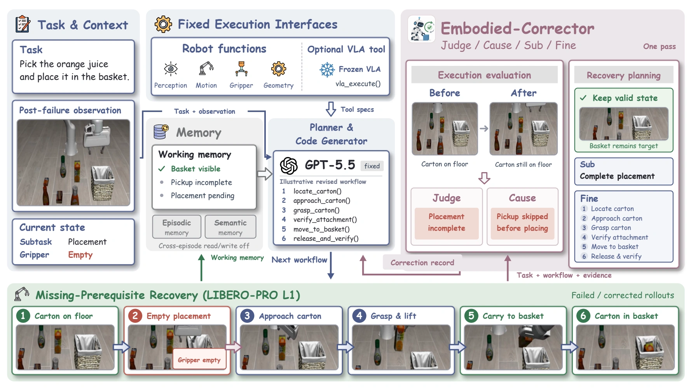

<div align="center">
  

# Embodied-Corrector

**Learning from Feedback for Physical Failure Understanding and Correction**

**English** · [中文](README_zh.md)

[](https://pm1255.github.io/embodied-corrector/)
[](docs/assets/paper.pdf)
[](https://github.com/pm1255/embodied-corrector)
[](guides/validation.md)

</div>

A research implementation for diagnosing physical execution failures and generating actionable corrections. The model reads public observations and execution feedback, then produces four linked fields: **Judge → Cause → Sub → Fine**.

This repository includes a paper project page, evaluation-first supervised fine-tuning, Noise-Aware Entropy-Gated Policy Optimization (**NEPO**) using **verl**, and a real **EmbodiedBench / EB-ALFRED** planning–execution–correction loop.

> **Implementation status.** The Qwen3-VL-2B single-GPU training and simulator pipelines have been executed end to end. This is a paper-derived implementation using verl's DataProto and GRPO/PPO kernels, not a native distributed RayPPOTrainer/FSDP integration. The small validation run does **not** reproduce the paper's benchmark performance.

## News

- **2026-10-24:** Initial release of the project page, Qwen + verl training pipeline, and real EB-ALFRED integration. Eighteen numerical and interface checks passed. See the [validation record](guides/validation.md).

## Overview

<p align="center"></p>

A physical failure is useful feedback only when it can be connected to an observable cause and an executable recovery. Embodied-Corrector links execution judgment, cause analysis, corrective subtask selection, and fine-grained action guidance in one structured response.

| Field | Purpose |
|---|---|
| **Judge** | Decide whether the preceding subtask succeeded. |
| **Cause** | Identify a cause supported by observable evidence. |
| **Sub** | Select the next executable recovery subtask. |
| **Fine** | Describe concrete recovery actions and verification. |

## Method

<p align="center"></p>

1. **Evaluation-first SFT:** learn Judge/Cause, then learn Sub/Fine conditioned on a verified evaluation prefix.
2. **Paired policy scoring:** the same unchanged policy scores identical sampled planning tokens under generated and verified evaluation prefixes. Images and public evidence remain identical.
3. **NEPO:** add a sampled-token probability gap to the group-relative advantage. Preserve positive guidance and attenuate negative guidance at high-entropy positions.
4. **Closed-loop execution:** a planner chooses an action, the environment executes it, and the corrector supplies feedback for the next planning decision.

For sampled token probabilities `p` and `q`, student entropy `h`, and planning mask `m`:

```text
s = q - p
g = sigmoid((kappa - h) / beta)
delta = m * (max(s, 0) + g * min(s, 0))
A = A_GRPO + coefficient * delta
```

The probability gap is not a log-probability ratio or KL divergence. Old-policy statistics, teacher scores, and advantages are detached before the optimizer update. See [method and implementation boundaries](guides/method.md).

## Installation

Linux, Python 3.12 and a CUDA GPU are recommended. Validation used one H100 with Qwen3-VL-2B-Instruct and LoRA. Install [uv](https://docs.astral.sh/uv/getting-started/installation/), then:

```bash
git clone https://github.com/pm1255/embodied-corrector.git
cd embodied-corrector
bash scripts/setup.sh
```

The repository vendors **verl v0.9.1** at a fixed commit. PyTorch is installed separately from the CUDA 12.8 wheel index; other core versions are pinned in [requirements-core.txt](requirements-core.txt). The exact environment used for validation is documented separately in [guides/validation.md](guides/validation.md).

## Train with Qwen

Prepare a local copy of [`Qwen/Qwen3-VL-2B-Instruct`](https://huggingface.co/Qwen/Qwen3-VL-2B-Instruct), including model weights, tokenizer and processor files:

```bash
export EC_MODEL=/path/to/Qwen3-VL-2B-Instruct
bash scripts/validate_gpu.sh
```

This runs numerical checks, a real multimodal alignment check, two SFT stages, two NEPO updates, checkpoint saving, evaluation, and checkpoint reload evaluation. Four illustrative paper-derived examples are included solely for this software validation.

For your own dataset:

```bash
source scripts/env.sh
"$EC_PYTHON" -m ec_verl.data split --input /data/all.jsonl --output /data/split
"$EC_PYTHON" -m ec_verl.data validate \
  --train /data/split/train.jsonl --eval /data/split/eval.jsonl

bash scripts/train.sh \
  --model "$EC_MODEL" \
  --train /data/split/train.jsonl --eval /data/split/eval.jsonl \
  --output runs/my-run --device cuda --dtype bfloat16 --lora \
  --scope formal --sft-steps 1000 --nepo-steps 500 --group-size 4 \
  --kappa 1 --beta .5 --opd-coef 1
```

These hyperparameters are engineering examples, not values disclosed by the paper. Split by original source trajectory before constructing perturbation branches. Image inputs require a vision-language model. See [data schema](guides/data.md) and [中文训练说明](guides/training_zh.md).

## EmbodiedBench evaluation

<p align="center"></p>

The adapter executes the official **EBAlfEnv**. A base Qwen model acts as planner, and the trained LoRA checkpoint acts as corrector. Only public observations, actions and feedback enter model prompts; task success is measured using the environment's own predicate.

After preparing the pinned EmbodiedBench repository, task data, AI2-THOR build and display dependencies described in [the environment guide](guides/embodiedbench.md):

```bash
export EC_EB_ROOT=/path/to/EmbodiedBench
export EC_THOR_EXECUTABLE=/path/to/thor-201909061227-Linux64
export EC_CORRECTOR="$PWD/runs/qwen-vl-smoke/checkpoints/nepo-0002"
bash scripts/validate_embodiedbench.sh
```

The default run evaluates one real base-subset task with a 30-decision budget. Per-step images, actions, raw and normalized corrections, environment feedback and final metrics are saved. The script closes its inference and display processes on exit.

This Qwen planner verifies the interface; it differs from the fixed planner in the manuscript. Habitat, Navigation and Manipulation backends are not implemented here.

## Validation results

| Check | Observed result |
|---|---|
| Numerical, data and interface tests | **18 passed** |
| Multimodal alignment | Images retained; matching-prefix log-probability difference ≤ 3.82e-6 |
| SFT | 12 assessment steps + 12 planning steps; checkpoints saved |
| NEPO | 2 updates; **154 planning tokens**, nonzero privileged signal, changed parameters |
| Checkpoint reload | Evaluation predictions identical to the saved model |
| Diagnostic teaching examples | Valid format 2/2; joint four-field match **0/2** |
| Real EB-ALFRED episode | **11 action calls**, **10 structured corrections**, environment terminated normally |
| EB-ALFRED task success | **0/1** |

These results establish executable software paths. They do not establish reliable correction ability or replicate manuscript tables. Action calls include actions rejected by the environment, and structural validity does not imply correct diagnosis. See [full validation details](guides/validation.md) and [machine-readable records](validation/).

The project website separately presents **paper-reported** figures and results, clearly labeled as such.

## Monitoring

```bash
source scripts/env.sh
"$EC_PYTHON" -m tensorboard.main \
  --logdir "$EC_ROOT/runs" --port 6006 --bind_all --load_fast=false
```

Open `http://localhost:6006`. Logs include stage waiting/running/completed/failed states, SFT loss, NEPO reward/entropy/probability gap, gradients, checkpoints and evaluation progress. Smoke and formal curves are separated.

## Data and checkpoints

The full training corpus, official EmbodiedDiag-Bench annotations, manuscript grader, pretrained Qwen weights and trained model checkpoints are not bundled. The four included paper-derived examples are labeled as demonstration fixtures. Synthetic text fixtures can be generated with `ec_verl.data fixture`.

Checkpoints are saved by stage. Optimizer-state resume, native distributed verl training and paper-scale performance evaluation are not supported or validated in this release.

## Repository structure

```text
.
├── ec_verl/          # SFT, NEPO, inference and benchmark adapters
├── scripts/          # Setup, training and validation entry points
├── configs/          # Documented smoke-run settings
├── data/             # Four labeled teaching examples
├── tests/            # Numerical, leakage and interface checks
├── guides/           # Method, data, environment and validation notes
├── validation/       # Small machine-readable verification records
├── docs/             # Author-free project page for GitHub Pages
└── vendor/verl/      # Pinned upstream verl source and license
```

## Acknowledgements and rights

Built with [verl](https://github.com/verl-project/verl), [Transformers](https://github.com/huggingface/transformers), [PEFT](https://github.com/huggingface/peft), [Qwen](https://github.com/QwenLM/Qwen3-VL), [EmbodiedBench](https://github.com/EmbodiedBench/EmbodiedBench) and [AI2-THOR](https://github.com/allenai/ai2thor). Repository presentation takes inspiration from [VLA-Corrector](https://github.com/ZJU-OmniAI/vla-corrector).

Third-party code retains its original license. See [THIRD_PARTY_NOTICES.md](THIRD_PARTY_NOTICES.md). The manuscript and its figures retain their respective rights. No author list or incomplete citation is added in this release.
