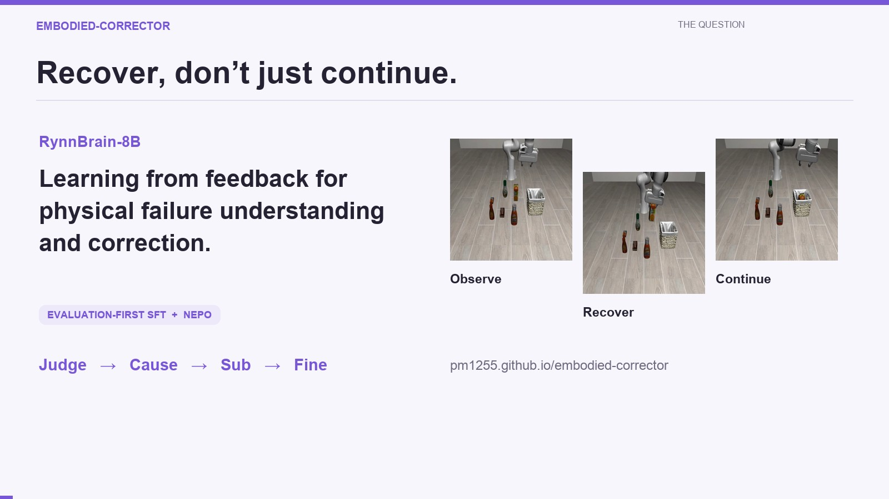
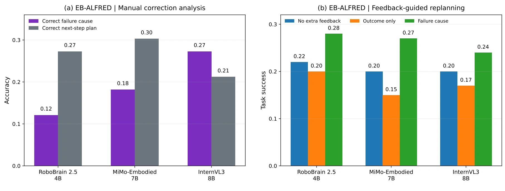
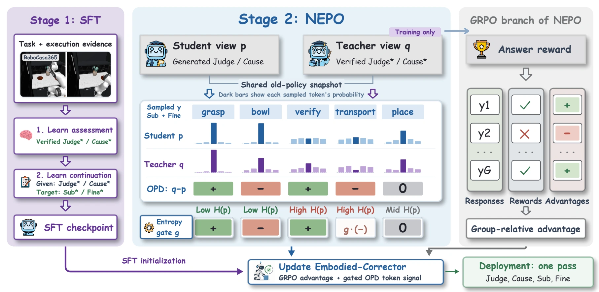

<div align="center">
  

# Embodied-Corrector

**Learning from Feedback for Physical Failure Understanding and Correction**

[English](README.md) · **中文**

[项目主页](https://pm1255.github.io/embodied-corrector/) · [论文 PDF](docs/assets/paper.pdf) · [视频介绍](https://pm1255.github.io/embodied-corrector/#video) · [训练说明](guides/training_zh.md)

</div>

## 论文视频介绍

[](https://pm1255.github.io/embodied-corrector/#video)

[▶ 观看介绍视频](https://pm1255.github.io/embodied-corrector/#video) · [下载 MP4](https://pm1255.github.io/embodied-corrector/assets/video/introduction.mp4) · [中英讲稿](docs/assets/video/transcript.md)

视频介绍研究动机、RynnBrain 训练方法、NEPO 和纠错案例。主页提供 **7 类案例**：4 个论文观察帧案例，以及导航、可达性、容器开合 3 类协议示意。观察帧按顺序展示，不代表原始连续视频。

## 研究动机

多模态模型已经能够理解任务、感知场景并生成计划，但物理执行会受到机器人形态、控制器能力和环境状态的共同约束。动作的实际结果可能偏离预期，继续沿用原有计划就可能重复失败。我们的核心问题是：**如何让具身大脑理解执行为什么失败，并从交互反馈中形成当前执行器能够完成的恢复方案？**

这需要三种相互补充的能力：

- **物理因果理解与失败定位**：沿执行过程找到最先破坏任务进展的动作、物理关系或缺失前提，例如区分抓取时机错误、接触姿态不当和前置步骤遗漏。
- **执行能力识别与适应**：根据当前状态和执行器能力调整指令内容与粒度，将恢复目标转化为固定控制器或冻结 VLA 可以执行的子任务。
- **从交互经验中学习**：把历史动作、观察和纠错结果作为下一步决策的证据，在推理时通过上下文修正行为，无需更新模型参数。

<p align="center"></p>

## 我们的方法

我们提出基于 **RynnBrain-8B** 训练的 **Embodied-Corrector**，将物理执行反馈转化为原因诊断与可执行恢复。模型按照 **Judge → Cause → Sub → Fine** 依次判断执行结果、定位失败原因、选择恢复子任务并生成细粒度动作指导，使恢复计划建立在对执行过程的评估之上。

<p align="center"></p>

1. **可控失败—恢复数据构建**：从成功轨迹的子任务边界出发，对单个物理因素施加干预，建立动作、可观察后果、失败原因与恢复方案之间的对应关系。保留可观察、可恢复的失败，并在生成扰动前按源轨迹划分训练与评估数据。
2. **评估优先的监督微调**：先学习执行结果与失败原因（Judge/Cause），再学习在已验证评估条件下生成恢复计划（Sub/Fine），将诊断与规划联系起来。
3. **NEPO 策略优化**：针对训练时使用已验证评估、部署时依赖模型自身评估的差异，用同一策略在两种评估上下文下对相同规划 token 打分。Noise-Aware Entropy-Gated Policy Optimization（NEPO）将组相对奖励与 token 概率差信号结合，保留正向指导，并用熵门控衰减不确定位置的负向信号。
4. **基于交互历史的闭环纠错**：在固定执行后端上观察结果、诊断原因并修订后续计划。模型通过当前回合的历史动作和反馈调整决策，执行后端保持固定，推理过程中不更新参数。

已验证评估仅用于训练；部署时模型从可观察执行证据生成完整的四字段响应。算法与代码对应关系见 [方法说明](guides/method.md)。

## 安装和训练

论文模型的训练路线为 **RynnBrain-8B → 评估优先 SFT → NEPO → Embodied-Corrector**。下列 Qwen3-VL 命令是便于运行的代码流程示例；论文模型及主页中的论文结果均基于 RynnBrain。

建议 Linux、Python 3.12、CUDA GPU。先安装 [uv](https://docs.astral.sh/uv/getting-started/installation/)，再执行：

```bash
git clone https://github.com/pm1255/embodied-corrector.git
cd embodied-corrector
bash scripts/setup.sh
export EC_MODEL=/path/to/Qwen3-VL-2B-Instruct
bash scripts/validate_gpu.sh
```

模型目录需包含完整 Qwen 权重、tokenizer 和 processor。上述脚本执行多模态对齐检查、两阶段 SFT、NEPO、检查点保存和重新加载评估。

自己的数据需先按原始轨迹划分，避免同源泄漏：

```bash
source scripts/env.sh
"$EC_PYTHON" -m ec_verl.data split --input /data/all.jsonl --output /data/split
bash scripts/train.sh \
  --model "$EC_MODEL" \
  --train /data/split/train.jsonl --eval /data/split/eval.jsonl \
  --output runs/my-run --device cuda --dtype bfloat16 --lora \
  --scope formal --sft-steps 1000 --nepo-steps 500 --group-size 4
```

步数和 κ/β/λ 默认值是工程示例，不能视为论文披露的参数。完整说明见 [训练指南](guides/training_zh.md) 和 [数据格式](guides/data.md)。

## EmbodiedBench 评估

按照 [环境说明](guides/embodiedbench.md) 准备官方仓库、数据和 AI2-THOR：

```bash
export EC_EB_ROOT=/path/to/EmbodiedBench
export EC_THOR_EXECUTABLE=/path/to/thor-201909061227-Linux64
export EC_CORRECTOR="$PWD/runs/qwen-vl-smoke/checkpoints/nepo-0002"
bash scripts/validate_embodiedbench.sh
```

此代码流程示例中，基础 Qwen 充当规划器，训练后的检查点充当纠错器。模型只读取公开图像与执行反馈，环境 `task_success` 决定最终成功标志。实际动作、拒绝反馈、原始纠错和逐步图片都会保存。其他 EmbodiedBench 后端尚未适配。

## 监控

```bash
source scripts/env.sh
"$EC_PYTHON" -m tensorboard.main --logdir "$EC_ROOT/runs" --port 6006 --bind_all --load_fast=false
```

打开 `http://localhost:6006`，可查看 SFT/NEPO loss、奖励、熵、概率差信号、梯度、检查点和评估进度。正式运行与 smoke 验证分开记录。

## 引用

如果这项工作对你的研究有帮助，欢迎引用 Embodied-Corrector。正式论文的 BibTeX 将在引用信息公开后补充；目前可使用以下条目引用项目主页。

```bibtex
@misc{embodiedcorrector2026,
  title        = {Embodied-Corrector},
  year         = {2026},
  howpublished = {Project page},
  url          = {https://pm1255.github.io/embodied-corrector/}
}
```

[下载项目引用条目](docs/citation.bib)

第三方源码与论文材料保留原有权利，见 [第三方说明](THIRD_PARTY_NOTICES.md)。
